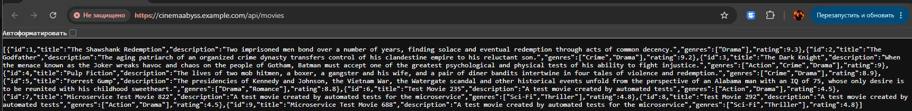

## Изучите [README.md](.\README.md) файл и структуру проекта.

# Задание 1

[Диаграмма контейнеров To-Be](https://www.plantuml.com/plantuml/png/bLPTRnj557tVNp54F2HIOp_04n9IqmJnqL2xjIk4X1IjxS4njNUjtLaY2o4bAUL3GIfK82I46l60U7KgXvWOEt_XxZ_Yd4pMcunJEtcmFJDxpxbtxhdtUk_6nezCqcchzLQWE_vQhHV7gXgktjDgFGoCZzCezjve1VLsqj1gsvXk_4wn6FaxXMRBR2Ur9DPH7POwC8Lws2bsstv0mjNODDgjMd7zxTKoZnv_l5di-B7H4Owsfjo5BcmzRtFjqzBZwbQrLDxQA7toO7d5yyfm70RBNxRqZexkg2NvBTsLORelnp9AVro2HQK7kixMlJ096dxKMuxFzpJzNOOobeaSmVX41bZtFmlaL4RIJ_T8aUwg-qbDHu4sEbvQKLzvIgdynijDt-WTlmUkjVA7wdsxMxBK4ncJGlu5BOXuAh_AW2v1_rpXuIJz3jxwIbwb1t82n2jiqZsQOpd42aS5tC5nosJ6vFipDrLo9XDUEIEoAM00hmbenM7jX4ZYBEr_sEnBNmRuZ45na3vJwJSof2yyXAyv5_x31Skn2tR3Y9DQN8zQNTCAW-ilES2tJSxf3Q_MzNiTLDvrTDIQq7zkdYaKMqE7BXT_P03KP4u-3c5ETR2tofzXqSS1bkDiFqdtc9jq7-KdGriTI22AXGPy00wWPmfZesPBOwD6Np_BBmkAeXp6fXdfoiDDK3bCjXnogciBOH79LJ5pBbV6XJoPW3c5AzqY2YjQnOIH9iLVpBkCMOa8uWSvTlGhrRxGTQDexpSrJ-H5zXm5t8Uge_HWHe67YKxqyXF_yoV-UQ3mGgauI7XJpXewesCRybhNhszhTPy8i7tjUOzqUphDilb2xnmH-414wg0mS8Z_e5ejL-weH-zLgiMFAgK7Z8WCKsGsAq3mZ4bdHTago_gGD9VmL-6s2bxNokIoKXw1ZoKzdCisqzk7UHqi15zkufTJ-ViCmgB1j8XZshals6Ks3m2Ui2K1jy8SknJao8RkfGRxc_ypLWwR2Uo_vuvuMuG4PYcqlxU2ElcwlBqTKPwxR7Kh-4NQyXPoiLbBdCFUOd42cKETq9r9c3wt_WVK15FlgPmfEPsPXUdJURfCU-uG-2DsjPnYHM9Q52BTRF6rGZV8uiUze8x5cyPlnk_QhIFN74B4yorhXGTCcnlfF0-v6FDzqEZYPQdRrcPXs9PgDiy_WN4VlFoJshNSLySlxy03B4TiwKdMMkd1pLpc8-8bxZ0MgZgwq3JIVcELQM5pSTZCp8ivFZplhWuQVF7x7m00)

# Задание 2


# Задание 3




# Задание 4
Для простоты дальнейшего обновления и развертывания вам как архитектуру необходимо так же реализовать helm-чарты для прокси-сервиса и проверить работу 

Для этого:
1. Перейдите в директорию helm и отредактируйте файл values.yaml

```yaml
# Proxy service configuration
proxyService:
  enabled: true
  image:
    repository: ghcr.io/db-exp/cinemaabysstest/proxy-service
    tag: latest
    pullPolicy: Always
  replicas: 1
  resources:
    limits:
      cpu: 300m
      memory: 256Mi
    requests:
      cpu: 100m
      memory: 128Mi
  service:
    port: 80
    targetPort: 8000
    type: ClusterIP
```

- Вместо ghcr.io/db-exp/cinemaabysstest/proxy-service напишите свой путь до образа для всех сервисов
- для imagePullSecret проставьте свое значение (скопируйте из конфигурации kubernetes)
  ```yaml
  imagePullSecrets:
      dockerconfigjson: ewoJImF1dGhzIjogewoJCSJnaGNyLmlvIjogewoJCQkiYXV0aCI6ICJaR0l0Wlhod09tZG9jRjl2UTJocVZIa3dhMWhKVDIxWmFVZHJOV2hRUW10aFVXbFZSbTVaTjJRMFNYUjRZMWM9IgoJCX0KCX0sCgkiY3JlZHNTdG9yZSI6ICJkZXNrdG9wIiwKCSJjdXJyZW50Q29udGV4dCI6ICJkZXNrdG9wLWxpbnV4IiwKCSJwbHVnaW5zIjogewoJCSIteC1jbGktaGludHMiOiB7CgkJCSJlbmFibGVkIjogInRydWUiCgkJfQoJfSwKCSJmZWF0dXJlcyI6IHsKCQkiaG9va3MiOiAidHJ1ZSIKCX0KfQ==
  ```

2. В папке ./templates/services заполните шаблоны для proxy-service.yaml и events-service.yaml (опирайтесь на свою kubernetes конфигурацию - смысл helm'а сделать шаблоны для быстрого обновления и установки)

```yaml
template:
    metadata:
      labels:
        app: proxy-service
    spec:
      containers:
       Тут ваша конфигурация
```

3. Проверьте установку
Сначала удалим установку руками

```bash
kubectl delete all --all -n cinemaabyss
kubectl delete  namespace cinemaabyss
```
Запустите 
```bash
helm install cinemaabyss .\src\kubernetes\helm --namespace cinemaabyss --create-namespace
```
Если в процессе будет ошибка
```code
[2025-04-08 21:43:38,780] ERROR Fatal error during KafkaServer startup. Prepare to shutdown (kafka.server.KafkaServer)
kafka.common.InconsistentClusterIdException: The Cluster ID OkOjGPrdRimp8nkFohYkCw doesn't match stored clusterId Some(sbkcoiSiQV2h_mQpwy05zQ) in meta.properties. The broker is trying to join the wrong cluster. Configured zookeeper.connect may be wrong.
```

Проверьте развертывание:
```bash
kubectl get pods -n cinemaabyss
minikube tunnel
```

Потом вызовите 
https://cinemaabyss.example.com/api/movies
и приложите скриншот развертывания helm и вывода https://cinemaabyss.example.com/api/movies

## Удаляем все

```bash
kubectl delete all --all -n cinemaabyss
kubectl delete namespace cinemaabyss
```
